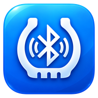

<p align="center">
  
</p>

<h1 align="center">TyrePing</h1>

<p align="center">
  <strong>Bluetooth Low Energy (BLE) TPMS Monitor for Android</strong>
</p>

<p align="center">
  
  
  
  <a href="LICENSE"></a>
</p>

TyrePing is an Android monitor for Bluetooth Low Energy tyre-pressure monitoring system sensors.

It is an independent fork of [TPMS Advanced](https://github.com/VincentMasselis/TPMS-advanced), maintained by [TerminalAddict](https://github.com/TerminalAddict). TyrePing retains the upstream project’s Android architecture and sensor support while providing its own application identity, release path, branding, and feature direction.

## Project status

TyrePing is under active development.

- **Application ID:** `nz.paulwillard.tyreping`
- **Repository:** `TerminalAddict/TyrePing`
- **Development branch:** `tyreping`
- **Distribution:** currently built and installed manually
- **Google Play:** not currently published

Because TyrePing has its own Android application ID, it can be installed alongside the original TPMS Advanced app. A Play Store update to TPMS Advanced will not overwrite TyrePing.

## Features

TyrePing currently inherits the core capabilities of TPMS Advanced, including:

- BLE scanning for supported TPMS sensors
- Live tyre pressure and temperature readings
- Low/high-pressure alerts
- Temperature alerts
- Multiple vehicle support
- Cars, motorcycles, trailers, and three-wheelers
- Pressure and temperature unit selection
- QR-code sensor binding
- Favourite sensor binding
- Latest recorded readings retained across app restarts
- Background monitoring
- Dark mode
- Android Auto support
- Direct vehicle shortcuts

Supported sensor families include formats used by Sysgration, Pecham, Bekubee/HRTPMS, Wicarlink/LYTPMS, and related compatible BLE sensors. Exact compatibility depends on the sensor’s BLE advertisement format.

## TyrePing identity

TyrePing is installed as a separate Android application:

```text
nz.paulwillard.tyreping
```

The internal Kotlin package names remain based on the upstream project for now. They do not affect TyrePing’s ability to install as an independent app.

## Building

### Requirements

- Git
- Android Studio
- Android SDK and platform tools
- Java supplied by Android Studio, or another compatible JDK

On Windows, the usual Java location is:

```text
C:\Program Files\Android\Android Studio\jbr
```

### Clone

```bash
git clone --branch tyreping https://github.com/TerminalAddict/TyrePing.git
cd TyrePing
```

### Build a debug APK

Windows:

```cmd
gradlew.bat :app:phone:assembleDebug
```

Linux/macOS:

```bash
./gradlew :app:phone:assembleDebug
```

The debug APK is created at:

```text
app/phone/build/outputs/apk/debug/phone-debug.apk
```

### Install with ADB

```cmd
adb install -r app\phone\build\outputs\apk\debug\phone-debug.apk
adb install -r app\phone\build\outputs\apk\release\phone-release.apk
```

## Upstream synchronisation

The recommended remotes are:

```text
origin    https://github.com/TerminalAddict/TyrePing.git
upstream  https://github.com/VincentMasselis/TPMS-advanced.git
```

To update the local upstream-tracking `develop` branch:

```cmd
git fetch upstream
git switch develop
git pull --ff-only upstream develop
git push origin develop
```

Then merge reviewed upstream changes into TyrePing:

```cmd
git switch tyreping
git merge develop
```

Resolve and test any conflicts before pushing:

```cmd
gradlew.bat :app:phone:assembleDebug
git push
```

Upstream changes are selected deliberately. TyrePing does not have to adopt every behavioural or release change made by TPMS Advanced.

## Release methodology
```
powershell -NoProfile -ExecutionPolicy Bypass -File .\tyreping-release.ps1 -Version 0.4.0- Improved single-sensor QR binding
```

It will ask you to type RELEASE v0.4.0 before proceeding.

The output will be like:
```
D:\TyrePing-Releases\0.4.0\
    TyrePing-v0.4.0.apk
    SHA256SUMS.txt
    RELEASE_NOTES.md
```

or use `-Stable` when you want a normal release rather than a pre-release.

Importantly: The script never uploads your keystore or keys.json. It also refuses to publish an APK whose signing certificate doesn't match the permanent TyrePing certificate.

## Development direction

Planned or under evaluation:

- Separate front and rear pressure ranges
- Additional BLE sensor formats
- Additional motorcycle-focused monitoring features
- Optional display and notification settings

Features may be adapted from other open-source projects only after checking licence compatibility and attribution requirements.

## Safety

TyrePing is an advisory monitoring tool, not a replacement for regular tyre inspection or a calibrated pressure gauge.

Do not rely solely on the app for vehicle safety decisions. Check tyre pressures manually and follow the vehicle and tyre manufacturers’ recommendations.

## Upstream project

TyrePing is based on:

- [VincentMasselis/TPMS-advanced](https://github.com/VincentMasselis/TPMS-advanced)

Generic fixes and improvements that are useful to the upstream project may still be contributed back where appropriate.

## Licence

TyrePing retains the upstream project’s Apache License 2.0 licensing.

See [LICENSE](LICENSE) for the full licence text.

The TyrePing name, package identity, branding, and launcher artwork are specific to this fork. References to the upstream project do not imply endorsement by its original author.
